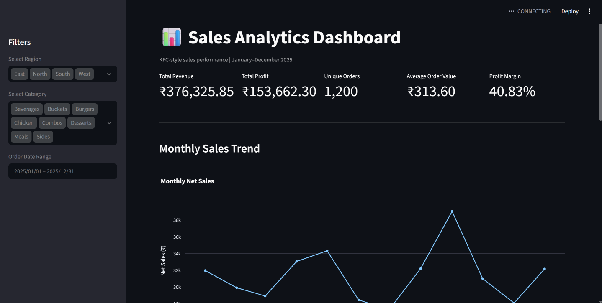

# InsightGen-AI — Interactive Sales Analytics Dashboard

An interactive sales analytics dashboard built with Python, Pandas, Plotly, and Streamlit to explore sales performance, profitability, product revenue, and regional trends.

## 🚀 Live Demo

Try the deployed dashboard here:

[Open InsightGen-AI Dashboard](https://insightgen-ai-egu7knnbmnqkf6qg6girfs.streamlit.app/)

## 📸 Dashboard Preview



## Overview

InsightGen-AI includes a sales analysis workflow that cleans raw data, calculates business KPIs, and presents actionable insights through interactive visualizations.

## Features
- Data cleaning and duplicate removal
- Missing-value and data-quality checks
- Revenue, profit, AOV, and profit margin KPIs
- Monthly sales trend analysis
- Category-wise and region-wise performance
- Top-performing product analysis
- Interactive region, category, and date filters
- Exportable analysis outputs and charts

## Tech Stack

- Python
- Pandas
- Matplotlib
- Plotly
- Streamlit

## Key Results

| Metric | Result |
|---|---:|
| Cleaned records | 1,200 |
| Total revenue | ₹376,325.85 |
| Total profit | ₹153,662.30 |
| Average order value | ₹313.60 |
| Profit margin | 40.83% |

*Results are based on the current dataset.*

## Project Structure

```text
InsightGen-AI/
├── agents/
├── dashboard/
├── data/
├── reports/
├── utils/
├── analysis.py
├── app.py
├── dashboard.py
├── visualizations.py
├── requirements.txt
└── README.md
```

## Run Locally

1. Clone the repository:

```bash
git clone https://github.com/harshraj71/InsightGen-AI.git
cd InsightGen-AI
```

2. Create and activate a virtual environment if needed.

3. Install dependencies:

```bash
python -m pip install -r requirements.txt
```

4. Start the sales dashboard:

```bash
python -m streamlit run dashboard.py
```

5. Open the local URL shown in your terminal.

## Business Value

The dashboard helps users compare sales performance across time periods, identify high-revenue products, and evaluate category and regional contributions.

## Future Enhancements

- Add customer segmentation
- Add automated business reports
- Deploy the dashboard online
- Add sales forecasting

## Author

Harsh Raj

## Disclaimer

This project is intended for educational and portfolio purposes. Dataset usage and redistribution should follow the applicable permissions and license.
